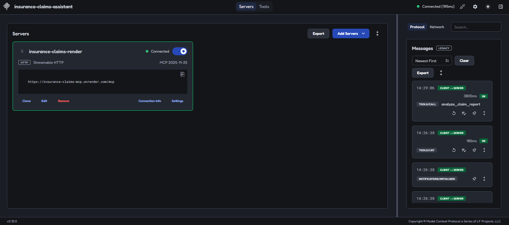
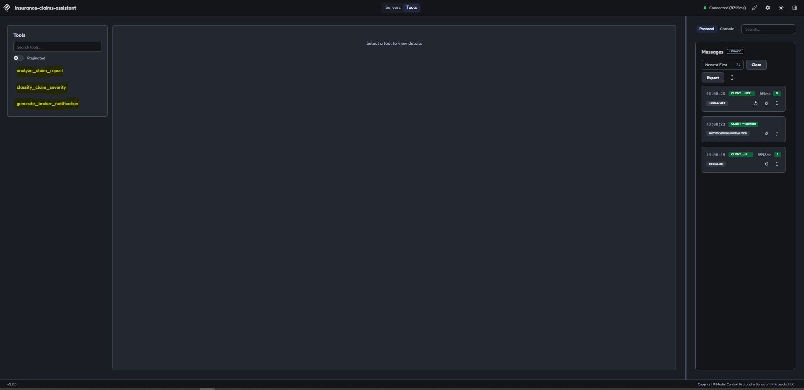
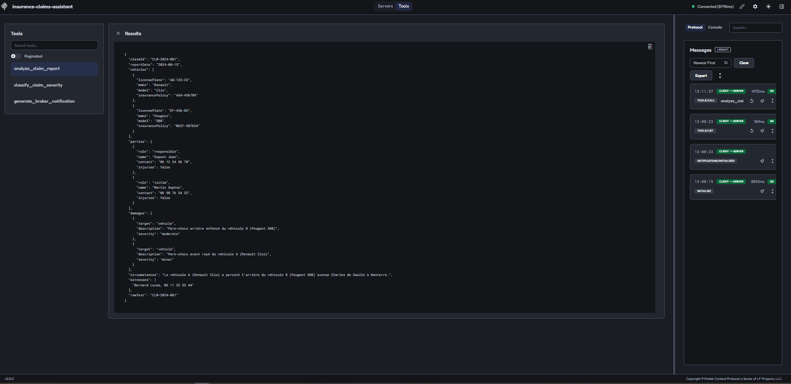
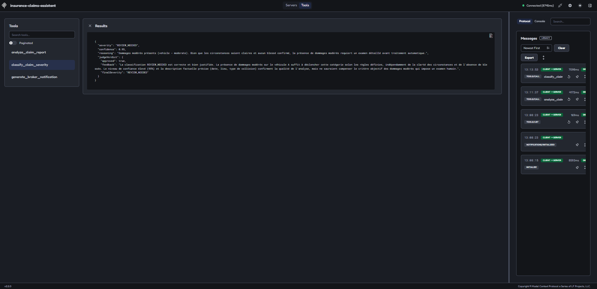
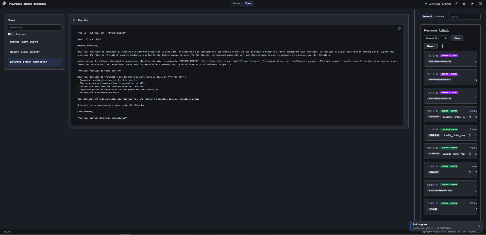

# Insurance Claims Assistant

[](https://insurance-claims-mcp.onrender.com)

A remote MCP server for automated car insurance claim processing, built with TypeScript and the Anthropic Claude API. It runs over stdio or Streamable HTTP with bearer token auth, and is deployed on Render.

I built this after a year working on Guidewire ClaimCenter at AXA France, where I integrated the EDI broker flows (506/508/509) for automated claim opening and modification. The business logic here mirrors what I dealt with there (entity extraction, severity triage, broker notifications), but implemented with LLMs instead of static rules.

The core of it is a two-model validation pipeline: a fast model classifies, a stronger model reviews and can overrule it before anything ships.

## What it does

Three tools, chained together:

```text
Raw claim text
    ↓  analyze_claim_report
Structured ClaimData
    ↓  classify_claim_severity
Severity + judge verdict
    ↓  generate_broker_notification
Formal broker notification
```

## Remote server

The server is deployed on Render and reachable over Streamable HTTP:

| Resource | Value |
| --- | --- |
| Status page | [insurance-claims-mcp.onrender.com](https://insurance-claims-mcp.onrender.com) |
| MCP endpoint | `POST https://insurance-claims-mcp.onrender.com/mcp` |
| Health check | `GET /health` |
| Auth | `Authorization: Bearer <token>` on every `/mcp` request |

This is a portfolio project running as a technical demo. It has no real users, and the token is not public because every tool call spends my Anthropic credit. To try the tools, run the server locally with your own API key (see [Setup](#setup)).

On Render's free plan the service sleeps after 15 minutes without traffic. The first request after that wakes it up, which takes 30 to 60 seconds.

MCP Inspector connected to the deployed server over Streamable HTTP, with the `initialize`, `tools/list` and `tools/call` messages in the protocol log:



### Connecting a client

For Claude Code, in a project `.mcp.json`:

```json
{
  "mcpServers": {
    "insurance-claims": {
      "type": "http",
      "url": "https://insurance-claims-mcp.onrender.com/mcp",
      "headers": {
        "Authorization": "Bearer <token>"
      }
    }
  }
}
```

Or from the command line:

```bash
claude mcp add --transport http insurance-claims https://insurance-claims-mcp.onrender.com/mcp --header "Authorization: Bearer <token>"
```

With MCP Inspector, run `npx @modelcontextprotocol/inspector`, add a server with the Streamable HTTP transport and the endpoint URL, then open its Settings and add a custom header named `Authorization` with the value `Bearer <token>`. The value must start with `Bearer` followed by a space. Without a valid header the server answers 401, and the Inspector falls back to an OAuth flow that this server does not implement (it fails on `/register`).

The same configuration works against a local server on `http://localhost:3000/mcp`.

## The judge

Classification runs through two models.

Claude Haiku takes the structured claim and returns a severity plus a confidence score and its reasoning. Claude Sonnet then receives the same claim data alongside Haiku's answer, and returns a verdict:

```json
{
  "approved": false,
  "feedback": "Injuries confirmed in the report, AUTO_PROCESS is not applicable",
  "finalSeverity": "URGENT_ESCALATION"
}
```

Sonnet doesn't ask Haiku to retry. It overrides directly, and `finalSeverity` is what the pipeline uses downstream. The judge always has the last word.

The reason this pattern is here and not somewhere cheaper: in claims processing, a misclassification isn't a cosmetic error. An `URGENT_ESCALATION` claim with injuries routed to `AUTO_PROCESS` means someone waits longer for assistance. Haiku is cheap enough to run on every claim; Sonnet costs more but only runs once, as a gate.

### analyze_claim_report

Takes raw accident report text and returns structured JSON: vehicles, parties, damages, circumstances, witnesses.

Uses an Agent Skill pattern: the extraction prompt lives in its own module (`skills/claim-extraction.skill.ts`) rather than being inlined in the tool.

### classify_claim_severity

Classifies a claim as `AUTO_PROCESS`, `REVIEW_NEEDED`, or `URGENT_ESCALATION`.

### generate_broker_notification

Generates a formal notification letter for the broker, with the required actions based on the severity classification.

This one sends MCP progress notifications (1/3, 2/3, 3/3) so the client can display real-time status.

## Architecture

```text
src/
├── index.ts                       Entry point, stdio transport
├── http.ts                        Entry point, Streamable HTTP + bearer auth
├── server.ts                      createServer(), tool registration
├── status-page.ts                 Public status page served on /
├── tools/
│   ├── analyze-claim.ts
│   ├── classify-claim.ts
│   └── generate-notification.ts
├── skills/
│   └── claim-extraction.skill.ts  Reusable prompt template
├── judge/
│   └── classification-judge.ts    Sonnet validates Haiku
├── utils/
│   ├── anthropic-client.ts        Shared SDK instance + model config
│   ├── logger.ts                  stderr logging
│   └── progress.ts                Progress callback type
└── types/
    ├── claim.types.ts
    └── claim.schemas.ts           Zod schemas for tool inputs
```

### A few decisions worth explaining

**Logging goes to stderr, not stdout.** MCP servers using stdio transport reserve stdout for JSON-RPC messages. A stray `console.log` corrupts the protocol and the client drops the connection. Everything logs to stderr instead.

**Haiku everywhere except the judge.** Extraction, classification, and notification generation all run on Haiku. Sonnet only runs as the validator. On a real claim volume, that cost difference matters.

**Progress notifications are optional.** The server only sends them when the client provides a progress token, and sends them on the stream of the request in progress. No client should crash because it didn't ask for progress updates.

**Zod for input validation.** The MCP SDK uses Zod schemas to validate tool inputs at the server boundary, before any business logic runs. `ClaimData` and `ClassificationResult` have full schemas, so an incomplete or malformed object is rejected before any Claude call. It also gives typed handler arguments for free.

**Stateless HTTP transport.** Each `POST /mcp` creates a fresh server and transport, handles the request, then disposes of them. No session lives in memory, so nothing is lost when Render puts the service to sleep or restarts it. The tools carry no state between calls anyway.

**A static bearer token, not OAuth.** The MCP spec recommends OAuth 2.1 for remote servers with many users. This one has a single user, so a static token read from an environment variable is the proportionate choice. OAuth would be the next step for a multi-user setup. The server refuses to start without a token of at least 32 characters, so a configuration mistake cannot expose an open endpoint.

**Dependency updates through Dependabot.** Dependabot checks the npm packages and the Docker base image every week, and only proposes versions published at least 14 days earlier. Security fixes skip that delay. Since every push to `main` redeploys on Render, a Dependabot pull request is built and tested locally (`npm run build`, `npm run test:progress`) before it is merged.

**Constant-time token comparison.** The token check uses `crypto.timingSafeEqual` instead of `===`. A regular string comparison stops at the first different character, which in theory lets an attacker guess the token by measuring response times.

## Setup

Requires Node.js 18+ (developed and tested on Node.js 24) and an Anthropic API key.

```bash
git clone https://github.com/youssefmkb/insurance-claims-assistant
cd insurance-claims-assistant
npm install
cp .env.example .env    # add your API key and an auth token
npm run build
```

Generate an auth token for the HTTP transport:

```bash
node -e "console.log(require('crypto').randomBytes(32).toString('hex'))"
```

Run the server over stdio, for clients that launch it themselves:

```bash
node dist/index.js
```

Or over Streamable HTTP (listens on `PORT`, default 3000):

```bash
npm run start:http
```

Test it with MCP Inspector:

```bash
npx @modelcontextprotocol/inspector node dist/index.js
```

Run the full chain with progress notifications:

```bash
npm run test:progress                                       # stdio
npm run test:progress -- --url http://localhost:3000/mcp    # HTTP, token read from .env
```

### Docker

```bash
docker build -t insurance-claims-mcp .
docker run --rm --env-file .env -p 3000:3000 insurance-claims-mcp
```

The image is built in two stages, so only the compiled JavaScript and production dependencies ship. It runs as a non-root user, with tini as init process for clean shutdowns. Secrets are injected when the container starts and never copied into the image.

## Screenshots

Tools exposed by the server:



Entity extraction from a raw accident report:



Classification with the judge verdict:



Broker notification, with progress updates visible bottom right:



## Stack

Node.js, TypeScript, `@modelcontextprotocol/sdk` 1.x, Anthropic SDK (Haiku + Sonnet), Zod, Express, Docker. Transports: stdio and Streamable HTTP. Deployed on Render.

## V2 ideas

Things I'd add if this went further:

- **Actual email delivery.** Right now the notification is generated but not sent. Hooking up SendGrid or Nodemailer would close the loop.
- **Persistence.** Claims are stateless today. A database would let you track a claim across its lifecycle instead of processing each call in isolation.
- **MCP sampling.** Let the server request completions from the client's model rather than calling the API directly.

## Author

Youssef Mokhbi · [github.com/youssefmkb](https://github.com/youssefmkb) · [LinkedIn](https://linkedin.com/in/youssef-mokhbi-654a9b10a)
